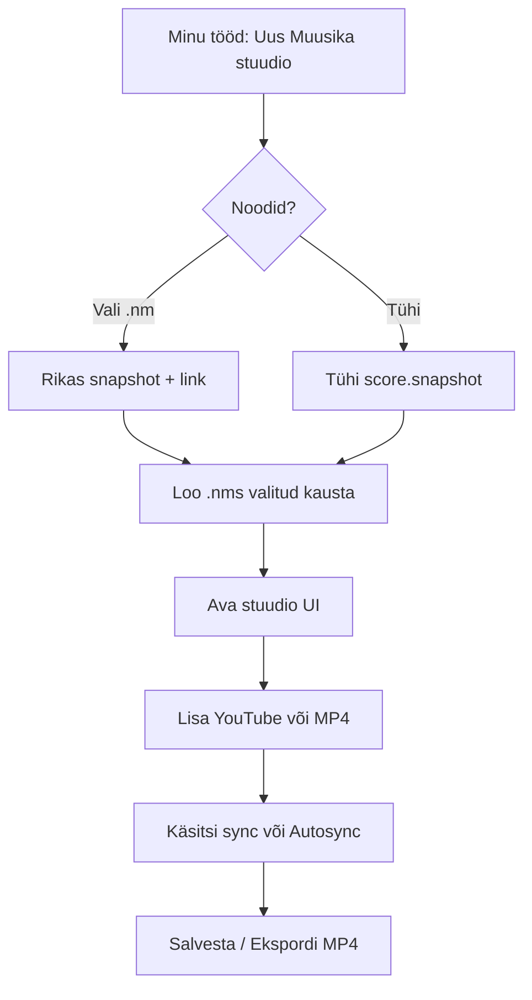
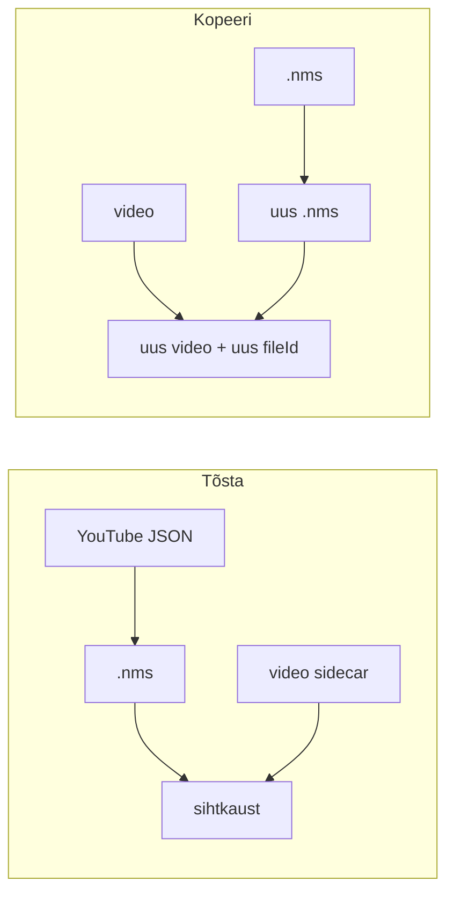

# Muusika stuudio — spetsifikatsiooni mustand (tagasisideks)

**Staatus:** disaini-/skeemi mustand (pole veel implementatsioon).  
**Seotud:** `AGENTS.md` → Standard: Muusika stuudio; `docs/PEDAGOGICAL-NOTATION-REQUIREMENTS.md` §5.4.

Palun tagasiside eriti: (1) Minu tööd nupud, (2) faililaiend vs `projectKind`, (3) snapshot vs linked noodid, (4) syncMap granulaarsus, (5) MP4 ekspordi sisu.

---

## 1. Mis see on (ühe lausega)

**Muusika stuudio** = õppematerjali montaaž: Noodimeistri noodid + õppevideo/heli + takti/löögi sync + harjutus + MP4 eksport. See **ei ole** noodigraafika redaktor.

```text
  [ Minu tööd ] ──Uus / Ava──►  [ Muusika stuudio ]
                                      │
                    ┌─────────────────┼─────────────────┐
                    ▼                 ▼                 ▼
              noodid (rikas)    video / audio      sync + MP4
```

---

## 2. Minu tööd — sisenemine (wireframe)

### 2.1 Peamine tegevuste rida (ettepanek)

```text
┌─ Minu tööd ──────────────────────────────────────────────────────────┐
│  Kaust: 📁 5. klass / flööt                                          │
│                                                                      │
│  [ + Uus töö ]  [ + Uus Muusika stuudio ]  [ Impordi töö ]  [ Kujundaja ]
│                                                                      │
│  Filtreeri:  (•) Kõik  ( ) Nooditööd  ( ) Stuudio  ( ) Kujundaja     │
│                                                                      │
│  ┌────────────────┐  ┌────────────────┐  ┌────────────────┐         │
│  │ 🎵 Lauluke.nm  │  │ 🎬 Lauluke     │  │ 🎨 Taust.nmc   │         │
│  │ nooditöö       │  │ õppetund.nms   │  │ kujundaja      │         │
│  │                │  │ Muusika stuudio│  │                │         │
│  └────────────────┘  └────────────────┘  └────────────────┘         │
└──────────────────────────────────────────────────────────────────────┘
```

**Märkus:** ikoon/märgis peab stuudio faile eristama `.nm` / `.nmc` failidest.

### 2.2 “Uus Muusika stuudio” dialoog

```text
┌─ Uus Muusika stuudio ─────────────────────────────┐
│  Pealkiri: [ ___________________________ ]        │
│                                                   │
│  Noodid                                           │
│  (•) Tõmba olemasolevast Noodimeistri tööst…     │
│      [ Vali fail… ]  → Lauluke.nm                 │
│  ( ) Alusta tühjana (noodid hiljem)               │
│                                                   │
│  Salvesta kausta:  [ 📁 5. klass / flööt     ▾ ]  │
│                                                   │
│            [ Tühista ]  [ Loo stuudio ]           │
└───────────────────────────────────────────────────┘
```

### 2.3 Kaustatoimingud (sama UX mis teistel töödel)

| Tegevus | Käitumine |
|--------|-----------|
| **Tõsta** | Stuudio `.nms` + üleslaetud video-sidecar(id) → sihtkaust; YouTube jääb JSON-i |
| **Kopeeri** | Uus `.nms` + **uued** media failid `(koopia)`; ei jaga `fileId` |
| **Nimeta ümber** | Ainult kuvatav/failinimi; ID püsib |
| **Ava** | Stuudio runtime (mitte noodistus A/B/C) |

---

## 3. Stuudio ekraan (wireframe)

```text
┌─ Muusika stuudio · Lauluke õppetund ────────────────── [Salvesta] [MP4▾] ─┐
│  [ Lae / uuenda noodid ]  [ Video: YouTube | Fail ]  [ Sync ▾ ]  [▶ Harjuta] │
├──────────────────────────────────┬──────────────────────────────────────────┤
│                                  │  ┌─ õppevideo ─────────────────────────┐ │
│   NOODIGRAAFIKA                  │  │                                     │ │
│   (rikas: sh fingering jms)      │  │         [ YouTube / MP4 player ]    │ │
│                                  │  │                                     │ │
│   ▌ playhead                     │  └─────────────────────────────────────┘ │
│                                  │                                          │
├──────────────────────────────────┴──────────────────────────────────────────┤
│  RULER / TIMELINE                                                           │
│  |--1--|--2--|--3--|--4--| … taktides (või löökides)                        │
│   ▲         ▲                                                               │
│  sync      sync   [ + punkt ]  [ Autosync (AI)… ]  [ Tühjenda ettepanek ]   │
└─────────────────────────────────────────────────────────────────────────────┘
```

### Video allika paneel (ettepanek)

```text
┌─ Õppevideo ──────────────────────────────────────┐
│  Allikas                                         │
│  (•) YouTube link                                │
│      [ https://youtu.be/………              ]      │
│  ( ) Üleslaetud fail                             │
│      [ Vali MP4 / WebM… ]  õpetaja-demo.mp4     │
│  ( ) Ainult heli (MP3…)                          │
│                                                  │
│  [ Eemalda media ]                               │
└──────────────────────────────────────────────────┘
```

### Autosync dialoog (ettepanek)

```text
┌─ Autosync (AI) ──────────────────────────────────┐
│  Võrdleb video tempot / struktuuri nootide        │
│  ajateljega ja pakub taktipõhist sync’i.          │
│                                                  │
│  Eelvaade: 12 takti → 12 syncpunkti (mustand)    │
│  ⚠ 2 takti ebakindel — märgi üle vaatamiseks     │
│                                                  │
│  [ Tühista ]  [ Rakenda ettepanek (muudetav) ]   │
└──────────────────────────────────────────────────┘
```

---

## 4. Failid ja salvestuskeskkond

```text
Kasutaja Drive / OneDrive kaust
├── Lauluke.nm                    ← algne nooditöö (ei overwrite’ita stuudio poolt)
├── Lauluke õppetund.nms          ← stuudio dokument (JSON)
└── Lauluke õppetund.video.mp4    ← sidecar (ainult kui allikas = üleslaaditud fail)
    (või peidetud `_assets/` alamkaust — otsustada tagasisides)
```

| Keskkond | Käitumine |
|----------|-----------|
| Google / Microsoft | Tõde = pilvefaili ID; sama konto `provider + email` tööruum |
| Kohalik | Fallback (dev); sama JSON skeem |
| YouTube | Faili pole; ainult viide dokumendis |

**Laiend (ettepanek tagasisideks):** `.nms` = Noodimeister Studio. Alternatiiv: `.nm` + `projectKind: "musicStudio"` (üks laiend, meta eristab).

---

## 5. JSON skeem (mustand)

Väljad on **ettepanek**; nimed võivad muutuda, semantika peaks püsima.

```jsonc
{
  "type": "noodimeister-music-studio",
  "schemaVersion": 1,
  "projectKind": "musicStudio",

  "meta": {
    "title": "Lauluke õppetund",
    "createdAt": "2026-10-23T12:00:00.000Z",
    "updatedAt": "2026-10-23T12:00:00.000Z"
  },

  // --- Noodid: rikas snapshot (+ valikuline link algsele tööle) ---
  "score": {
    "link": {
      "provider": "google",          // | "onedrive" | null
      "fileId": "…",                 // algne .nm (valikuline)
      "fileName": "Lauluke.nm",
      "importedAt": "2026-10-23T12:00:00.000Z"
      // Stuudio EI kirjuta seda faili vaikimisi üle
    },
    "snapshot": {
      // Täielik Noodimeistri projekti sisu (sama mida .nm kannab):
      // notes, lyrics, chords, fingering/augudiagrammid, notationMode,
      // pedagogical*, layoutOptions, … — RIKAS, mitte MusicXML-alamhulk
    }
  },

  // --- Media: täpselt üks aktiivne allikas ---
  "media": {
    "kind": "youtube",               // "youtube" | "videoFile" | "audioFile"
    "youtube": {
      "url": "https://www.youtube.com/watch?v=XXXXXXXXXXX",
      "videoId": "XXXXXXXXXXX",
      "title": null                  // valikuline cache
    },
    // kui kind === "videoFile" | "audioFile":
    "asset": null
    // "asset": {
    //   "provider": "google",
    //   "fileId": "…",
    //   "folderId": "…",
    //   "mimeType": "video/mp4",
    //   "fileName": "Lauluke õppetund.video.mp4",
    //   "sizeBytes": 12345678
    // }
  },

  // --- Sync: takt/beat ↔ media aeg ---
  "sync": {
    "mode": "measureMap",            // "measureMap" | "bpm" (legacy/lihtne) | "anchors"
    "unit": "measure",               // "measure" | "beat" — peamine UX = takt
    "points": [
      // Iga punkt: noodigraafika positsioon ↔ media sekund
      { "measureIndex": 0, "beatInMeasure": 0, "mediaSec": 2.40, "source": "manual" },
      { "measureIndex": 1, "beatInMeasure": 0, "mediaSec": 4.85, "source": "autosync" },
      { "measureIndex": 2, "beatInMeasure": 0, "mediaSec": 7.20, "source": "autosync", "uncertain": true }
    ],
    "autosync": {
      "lastRunAt": null,
      "status": "idle",              // "idle" | "proposed" | "applied"
      "proposalPointIds": []         // kuni kasutaja kinnitab / muudab
    }
  },

  "cues": [
    // Valikuline: stseenid / peidetud score jms (laiendab praegust ped cue mudelit)
    // { "id": "…", "startSec": 12.0, "label": "Sõrmitus", "hideScore": false }
  ],

  "playback": {
    "loop": null,                    // { startSec, endSec } või beat-vahemik
    "playheadStyle": "line",
    "showRuler": true
  },

  "export": {
    "defaultFormat": "mp4",
    "lastExport": null
    // "lastExport": { "at": "…", "fileName": "….mp4", "asset": { … } }
  }
}
```

### `CloudAsset` (korduvkuju)

```ts
type CloudAsset = {
  provider: 'google' | 'onedrive'
  fileId: string
  folderId?: string
  mimeType: string
  fileName: string
  sizeBytes?: number
}
```

### SyncMap semantika

```text
measureIndex 0 ──mediaSec 2.40──► video
measureIndex 1 ──mediaSec 4.85──► video
…

Playback: playhead noodil → interpolate / snap media ajale punktide järgi.
Klikk taktil → seek video; seek video → lähim / interpolatsioon noodis.
```

**Küsimus tagasisideks:** kas vaikimisi ainult **taktide** algused (`beatInMeasure: 0`) või kohe ka **löögitaseme** punktid?

---

## 6. Vood (mermaid)

### Loomine



### Move / copy



---

## 7. Eksport MP4

| Valik | Kirjeldus |
|-------|-----------|
| **Laadi alla** | Brauseri download |
| **Salvesta Minu tööd kausta** | Uus MP4 (või `export.lastExport.asset`) valitud kausta |

**Sisu (lahendada tagasisides):**  
A) ainult õppevideo (trim / sync-vahemik)?  
B) noodigraafika + playhead peal (nagu praegune animatsiooni eksport)?  
C) mõlemad valikud ekspordi menüüs?

YouTube’i **üleslaadimine** ei kuulu selle mustandi kohustuslikku skoopi (ainult sisend lingiga).

---

## 8. Seos pedagoogilise D-ga

| Praegu | Siht |
|--------|------|
| D = `pedagogicalDisplayMode: interactive` sama `.nm` sees | **Muusika stuudio** = eraldi dokument + Minu tööd tüüp |
| Audio + lihtne sync ped failis | Video + `sync.points` + autosync + MP4 |

Üleminekuvariant: olemasolev ped D media võib hiljem **migreeruda** `.nms` stuudiosse; A/B/C jäävad noodistuseks.

---

## 9. Tagasiside kontrollnimekiri

Palun märgi / kommenteeri:

1. [ ] Minu tööd: eraldi nupp **Uus Muusika stuudio** OK?
2. [ ] Fail: **`.nms`** vs `.nm` + `projectKind`?
3. [ ] Noodid: **snapshot + link** (soovitus) vs ainult link (alati loe live `.nm`)?
4. [ ] Video sidecar: sama kaust vs `_assets/` alamkaust?
5. [ ] Sync vaikimisi: **takt** vs takt+löök?
6. [ ] MP4 eksport: ainult video / noodid peal / mõlemad?
7. [ ] Kas stuudio peab toetama ka **traditsioonilist / figuurnotatsiooni** allikana (mitte ainult pedagoogilist)?

---

*Mustand v1 — mõeldud aruteluks enne implementatsiooni.*
